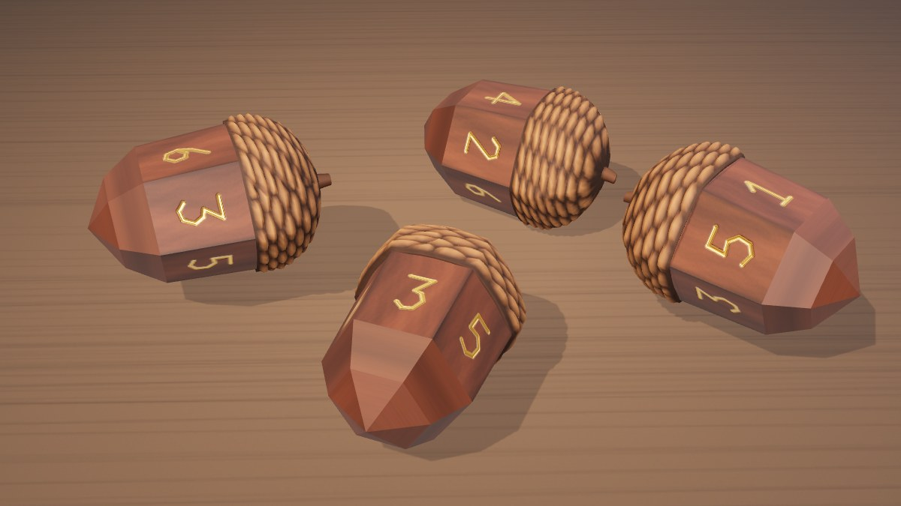
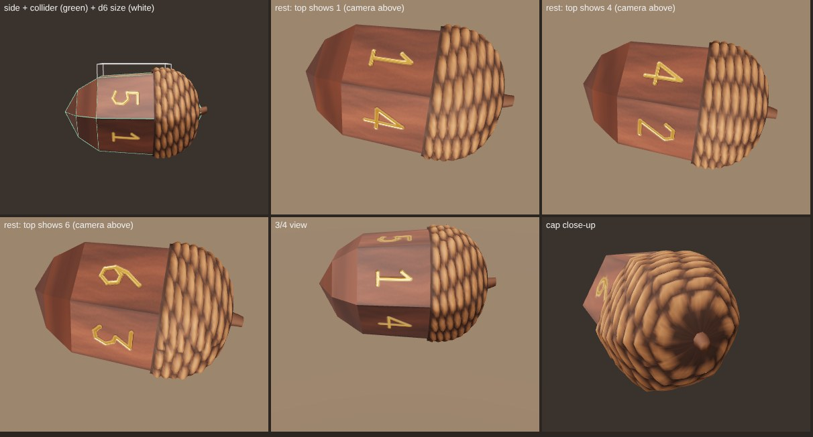

# Dados-Bolota · Acorn Dice



Um d6 em forma de bolota para o **Dice So Nice!** no Foundry VTT, em **qualquer sistema
de jogo**: números dourados gravados na madeira, chapéu escamado e uma forma física
própria, que faz a bolota rolar e deitar de lado como uma bolota de verdade.

Inspirado nos dados-bolota de *Legend in the Mist*. Desenho original de fã, sem
vínculo com a Son of Oak.

*English below.*

## Instalação

No Foundry: **Configurar → Módulos → Instalar Módulo** e cole na **URL do Manifesto**:

```
https://raw.githubusercontent.com/pedronaraujo/acorn-dice-litm/main/module.json
```

Ative o módulo no mundo, junto com o **Dice So Nice!** (versão 6 ou mais nova).

## Como usar

Nas configurações do módulo, **"Usar os dados-bolota em"**:

- **Todo d6, para todos** (padrão): todo d6 de toda rolagem aparece como bolota, para
  todos os jogadores, em qualquer sistema. Uma rolagem que já pede outro conjunto de dados
  (de outro módulo, por exemplo) é respeitada.
- **Escolha de cada jogador**: as bolotas só aparecem como opção ("Dados-Bolota") nas
  configurações do Dice So Nice, e cada jogador decide.

## A bolota é justa?

O número que vale é sempre o que o Foundry sorteou. O Dice So Nice só gira o dado no fim
do arremesso para mostrar esse número. Ou seja: a bolota nunca muda o resultado.

Mesmo assim, a física dela foi testada no motor do próprio Dice So Nice, sem a animação:

| Teste | 1 | 2 | 3 | 4 | 5 | 6 |
|---|---|---|---|---|---|---|
| Bolota, 5.000 arremessos de 2d6 (10.000 dados) | 16,5% | 17,1% | 15,9% | 18,0% | 16,0% | 16,5% |
| d6 cúbico do Dice So Nice, 2.000 arremessos | 19,7% | 14,3% | 17,0% | 14,7% | 16,2% | 18,2% |

O ideal seria 16,7% em cada face. Pela física, a bolota é mais equilibrada que o d6 padrão
do Dice So Nice. Ela para um pouco inclinada (uns 7°, porque afina para a ponta) e leva
cerca de 1 segundo a mais para parar, porque rola de lado.

## Detalhes técnicos

- `dice/acorn-d6.glb`: o modelo 3D (glTF, ~340 KB).
- `scripts/acorn-shape.js`: a forma de colisão, um prisma hexagonal com pontas. As pontas
  nunca dão resultado: se a bolota parar numa ponta, vale a face numerada mais próxima.
  Faces opostas somam 7, como num d6.
- `tools/build_acorn.py`: gera os dois arquivos acima por código (Python, numpy, Pillow,
  pygltflib). Mude cores, tamanho ou números e rode de novo.
- `./build.sh` monta `dist/acorn-dice-litm.zip`, o pacote que o Foundry instala.

---

## English

An acorn-shaped d6 for **Dice So Nice!** in Foundry VTT, in **any game system**: carved
golden numbers, a knobbly cup and its own physics shape, so it rolls and settles on its side
like a real acorn. Inspired by the acorn dice of *Legend in the Mist*; an original fan design,
not affiliated with Son of Oak.

**Install:** Foundry setup → Add-on Modules → Install Module → Manifest URL:
`https://raw.githubusercontent.com/pedronaraujo/acorn-dice-litm/main/module.json`.
Requires Dice So Nice! 6 or later.

**Use:** module setting **"Use acorn dice for"**: *Every d6, for everyone* (default; a roll
that already asks for another dice set keeps it) or *Each player's choice* (adds "Acorn Dice"
to the Dice So Nice settings).

**Fairness:** the value that counts is always Foundry's roll; Dice So Nice turns the die at
the end of the throw to show it. Physically, over 10,000 simulated dice in Dice So Nice's own
physics engine, each face landed 15.9–18.0% of the time (ideal 16.7%), more even than Dice
So Nice's standard cube under the same throws.



## Créditos · Credits

Pedro Tostes. Modelo e forma física gerados por código para este módulo.
Licença MIT (veja `LICENSE`).
